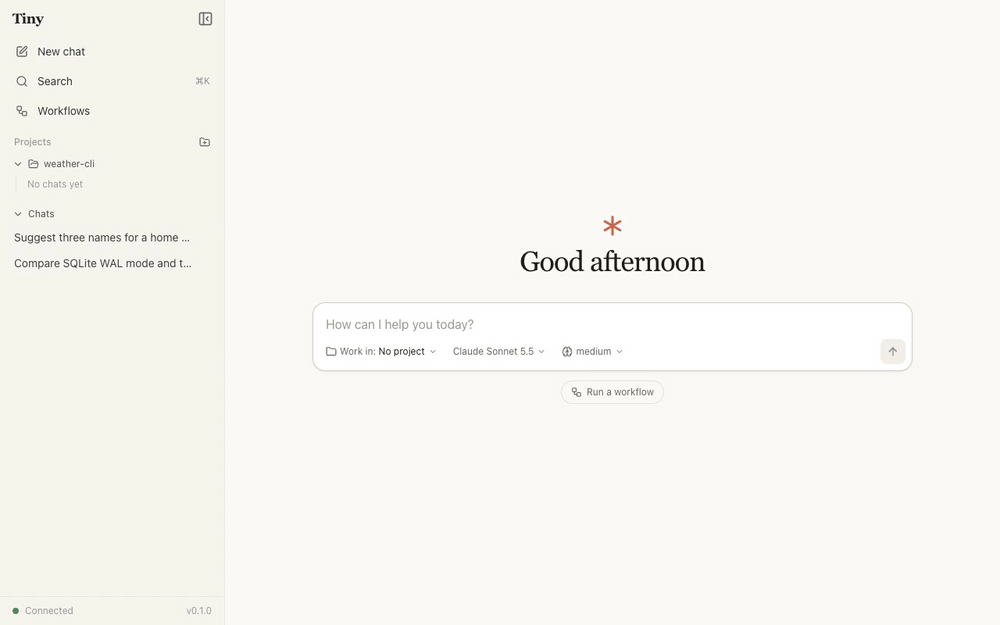
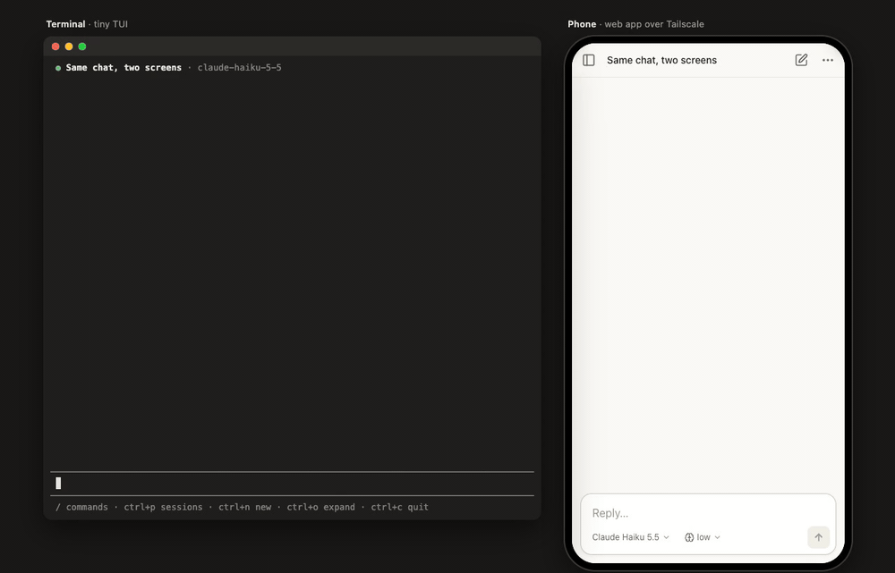
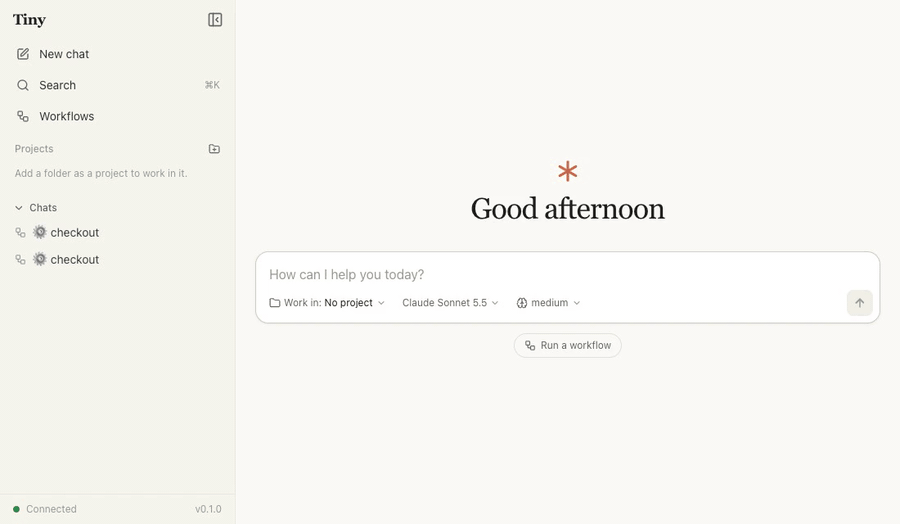
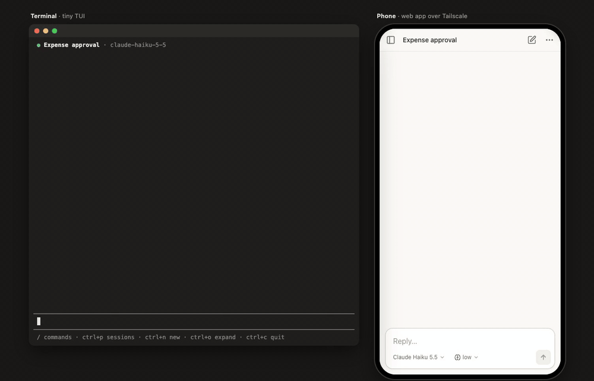

# tiny-assistant

A tiny, self-hosted personal AI assistant. One daemon on your own machine (a Mac mini, say) runs every conversation on
[pi-durable](https://github.com/earendil-works/pi/tree/main/packages/durable); a rich web app (for your phone, over
Tailscale) and a Claude Code-style terminal client connect to it and stay in sync.

**Ask from the web app.** A new chat in a project folder: the agent reads the code, edits it, runs it, and streams
every step. ([MP4](docs/media/web-demo.mp4))



**Same session, two clients.** A question typed in the terminal streams into the phone at the same time; a follow-up
sent from the phone appears in the terminal. ([MP4](docs/media/sync-demo.mp4))



## Features

- **Durable by default.** Every model turn, tool call, and workflow step is committed to SQLite before anything is
  shown. Restart the daemon mid-answer and the work picks up where it stopped.
- **Your Claude subscription.** Models run through the official `claude` CLI via
  [pi-claude-code](https://github.com/earendil-works/pi-claude-code), so it uses your Pro/Max plan. Other providers
  (OpenAI, Anthropic API, Google, OpenRouter, ...) plug in through pi-ai.
- **Code-driven tools and workflows.** Drop TypeScript files into `assistant/`; the daemon hot-reloads them.
- **Workflows that can undo and ask.** Steps are checkpointed; give them an `undo` and a failed or stopped run reverts
  itself (a saga). `ctx.ask()` pauses a run until you answer, for as long as it takes. Every run is drawn live.
- **Sessions and projects.** Start a chat, point it at a project folder, switch between sessions, search everything.
- **Pick the engine per chat.** Run a chat on tiny's own durable loop, or on Claude Code itself in the project, with
  your skills, plugins, hooks, MCP servers, and Claude in Chrome. Either way the session is stored, searchable, and
  streamed to every client.
- **One API.** REST + one WebSocket. The web app and the TUI use the same typed client (`@tiny/core`).
- **Logs you can analyze.** Transcripts, per-run tokens, cost, duration, and tool calls live in one SQLite file.

## How it fits together

```
 phone / laptop browser ─┐                       ┌─ pi-durable Harness ── claude -p (your subscription)
                         ├─ HTTPS (tailscale) ─┐ │   ├─ built-in tools: read, write, edit, bash
 tiny TUI (any machine) ─┘    REST + WebSocket ├─┤   ├─ assistant/tools/*.ts      (hot reload)
                                               │ │   └─ assistant/workflows/*.ts  (durable tasks)
                                daemon (Bun) ──┘ └─ SQLite: transcripts, tasks, sessions, search, run metrics
```

## Requirements

- [Bun](https://bun.sh) ≥ 1.3
- [Claude Code](https://code.claude.com) on your `PATH`, logged in to your subscription: `claude auth login`
- Optional: [Tailscale](https://tailscale.com) to reach the daemon from your phone

## Quick start

```sh
git clone https://github.com/tinnguyenhuuletrong/tiny-assistant.git && cd tiny-assistant
make install
make start            # builds the web app, starts the daemon on http://127.0.0.1:7777
make tui              # in another terminal
```

Open <http://127.0.0.1:7777>, or run the TUI.

### On your Mac mini, reachable from your phone

```sh
cp .env.example .env  # adjust if you like
make service-install  # launchd: starts at login, restarts if it dies; logs: make logs
make tailscale-serve  # https://<mac-mini>.<tailnet>.ts.net -> the daemon
```

On the phone, open the tailnet URL and use "Add to Home Screen". Only loopback and tailnet addresses may connect; set
`TINY_ALLOWED_LOGINS` to restrict it to your Tailscale identity, or `TINY_TOKEN` for a shared secret.

### The TUI from any machine

The daemon serves the TUI as one file:

```sh
curl -fsSL https://<mac-mini>.<tailnet>.ts.net/tui.js -o tiny.js
bun tiny.js https://<mac-mini>.<tailnet>.ts.net
```

In the TUI: type to chat, `/` for commands (`/new`, `/sessions`, `/project`, `/model`, `/run`, `/answer`, `/compact`,
...), `ctrl+p` switches sessions, `ctrl+o` expands tool output and thinking, `esc` stops a run. When a workflow in any
session asks you something, the TUI rings, the footer shows `? N questions waiting for you`, and `ctrl+g` jumps there.

## Engines

The engine runs a chat's turns. Pick it when you start a chat (the web app's **Run with** picker, `/engine` in the TUI);
each choice shows a note on what it does. The engine and model a chat starts with become the defaults for the next one.

| Engine          | What runs a turn                                                                                                                                                                                                                                                                                                                            |
| --------------- | ------------------------------------------------------------------------------------------------------------------------------------------------------------------------------------------------------------------------------------------------------------------------------------------------------------------------------------------- |
| **Tiny** (`pi`) | tiny's own loop on pi-durable. Every model turn and tool call is a durable task that picks up after a restart. Uses tiny's tools and workflows, and any model provider.                                                                                                                                                                     |
| **Claude Code** | Claude Code itself, through the [Claude Agent SDK](https://code.claude.com/docs/en/agent-sdk/overview), in the project folder, set up the way `claude` starts there: user, project, and local settings, so CLAUDE.md, skills, plugins, hooks, MCP servers, and permission rules load. Claude in Chrome is on, and permissions are bypassed. |

A Claude Code chat keeps Claude Code's own session and resumes it on every message. tiny records each turn into the
pi-durable session as it happens: messages, tool calls and results, usage and cost. So search, run metrics, Stop, and
the live view work as for any chat. The first turn notes what Claude Code loaded (version, model, tools, MCP servers,
skills).

What differs from a Tiny chat:

- **Durability.** Each finished message and tool result is committed as it arrives. If the daemon dies mid-turn, the
  turn ends `interrupted` and is not rerun, because its tools may already have changed files. Your next message
  continues Claude Code's session where it stopped.
- **Mid-turn messages.** Messages you send during a turn queue and run next (no steering).
- **Context.** `/compact` asks Claude Code to compact. `/reset` starts a new Claude Code session; the transcript stays.
- **Workflows.** They run in Tiny chats only.

Settings (`.env`): `TINY_ENGINES` (default `claude-code`; empty for Tiny only), `TINY_CLAUDE_PERMISSION_MODE`
(default `bypassPermissions`), `TINY_CLAUDE_CHROME` (`on`, `off`, `settings`), `TINY_CLAUDE_COMMAND`. The CLI uses your
Claude login: `ANTHROPIC_API_KEY` is dropped unless `TINY_CLAUDE_USE_API_KEY=1`.

**Adding an engine** (Codex, Antigravity, ...): implement `Engine` from
[`apps/server/src/engines/types.ts`](apps/server/src/engines/types.ts) and list it in `createEngines`
([`engines/index.ts`](apps/server/src/engines/index.ts)). An engine has an id, a name, a note, the model providers it
runs, an availability check, and `run(turn)`, which streams `session`, `partial`, `assistant`, `toolResult`, `retry`,
`notice`, and `done` events. The durable turn task ([`agent.ts`](apps/server/src/agent.ts)) and the clients do the rest.

## Tools

A tool is a pi-durable tool. Each call runs as its own durable task, its output streams to every client, and the model
gets the result:

```ts
// assistant/tools/now.ts
import { defineTool, obj, opt, str } from "@tiny/core/define";

export default defineTool({
	name: "now",
	description: "Current date and time in an IANA timezone",
	parameters: obj({ timezone: opt(str()) }),
	replay: "safe", // may run again if the daemon dies mid-call
	async execute(args) {
		const zone = args.timezone ?? "UTC";
		return { output: [{ type: "text", text: new Date().toLocaleString("en-GB", { timeZone: zone }) }] };
	},
});
```

A file may export one tool, several, an array, or a whole `defineExtension({ tools, sections, hooks })` (prompt
sections, `beforeTool` approval gates, and more: see the pi-durable README).

## Workflows

A workflow is code that drives the assistant through steps. Each `step()` result is checkpointed, so a run
interrupted by a crash or restart resumes after its last finished step:

```ts
// assistant/workflows/repo-review.ts
import { defineWorkflow, obj, opt, str } from "@tiny/core/define";

export default defineWorkflow({
	name: "repo-review",
	description: "Review uncommitted changes",
	input: obj({ focus: opt(str()) }),
	async run(ctx) {
		const diff = await ctx.exec("git diff --stat", { step: "stat" }); // checkpointed shell command
		if (!diff.output.trim()) return "nothing to review";
		await ctx.log(diff.output); // shows in the transcript
		return ctx.agent(`Review the uncommitted changes. Focus: ${ctx.input.focus ?? "correctness"}`, {
			step: "review", // a normal agent turn in the session, streamed to every client
		});
	},
});
```

Run it from the web app ("Run workflow"), the TUI (`/run repo-review {"focus":"security"}`), or the API
(`POST /api/workflows/run`). Stopping the session stops the run.

Give a workflow `examples` so people know what to type. The web app shows them as one-tap choices above a form built
from the input schema (with each field's `description` as its hint), and `/run <name>` in the TUI offers them as a
list. The daemon checks every example against the schema when it loads the file:

```ts
examples: [
	{ label: "General review", input: {} },
	{ label: "Security pass", input: { focus: "security: injection, secrets, unsafe input handling" } },
],
```

### Rollback (sagas)

Give a step an `undo` and the run can revert itself. If a later step fails, or you press Stop, the finished steps are
undone newest first. The pattern comes from the checkout example in
[the pi-durable post](https://earendil.com/posts/pi-durable/), where a declined card refunds the cards already charged:

```ts
// assistant/workflows/checkout.ts (abridged)
for (const card of ctx.input.cards) {
	await ctx.step(`charge ${card}`, () => bank.charge(`run-${ctx.runId}-${card}`, card, share), {
		undo: (charge) => bank.refund(charge.id), // gets the step's stored result
	});
}
await ctx.step("place order", () => placeOrder());
```

- The move into the rollback is checkpointed, and so is each undo: a crash mid-rollback resumes it, and no step is
  undone twice.
- Stop while a step is running lets it finish, then undoes it too. If the daemon crashes in the middle of a step, nobody
  can know whether it took effect, so the rollback says so ("check it by hand") instead of guessing. Make external
  calls idempotent (`ctx.runId` makes a good key) and undos safe to repeat.
- To find what to undo, the rollback replays `run()` with the stored step results, so keep `run()` deterministic
  (branch on step results, not on the clock).
- `ctx.exec(command, { undo: "shell command" })` is the same for shell steps; `check: true` fails the step when the
  command exits non-zero. Build commands from input with `shellQuote()` (from `@tiny/core/define`): text inside
  double quotes still runs `$(...)` and backticks.
  [`safe-change`](assistant/workflows/safe-change.ts) uses all of this: the agent changes your project on a throwaway
  git branch, and if your tests fail the branch and everything the attempt created are removed.

Every run is drawn live in the session: steps as they start and finish, and the rollback lane when a run reverts.
([MP4](docs/media/workflow-demo.mp4))



### Human in the loop

`ctx.ask()` stops the run until a person answers, then continues with the answer:

```ts
// assistant/workflows/expense-approval.ts (abridged)
await ctx.step("reserve budget", () => reserve(amount), { undo: (r) => release(r.id) });
const decision = await ctx.ask(`Approve ${amount} for "${description}"?`, {
	choices: ["Approve", "Reject"],
	timeoutMs: 30 * 60_000, // optional: no answer in time fails the run (and rolls back)
});
if (decision !== "Approve") throw new Error("Rejected"); // rolls back the reservation
await ctx.step("pay", () => pay(amount));
```

- The question appears in the session with its choices (or a text box). Waiting sessions get a "needs you" badge,
  and the TUI answers with `/answer`.
- While it waits, the run holds no process: it is a sleeping pi-durable task, so it can wait for days and survives
  restarts. Answering wakes it at once; finished steps return their stored results, and `ask` returns the answer.
- Stop, a rejection you turn into an error, or the timeout roll back the finished steps like any failure.
- [`release-notes`](assistant/workflows/release-notes.ts) loops on it: the agent drafts, you pick Publish, Revise
  (then say what to change), or Cancel.

Below, the TUI starts `expense-approval` from one of its examples; the run waits, and the phone answers it. Both
clients show the same run the whole time. ([MP4](docs/media/approval-sync.mp4))



`WorkflowContext`: `input`, `runId`, `sessionId`, `cwd`, `signal`, `step(name, fn, { undo })`, `agent(prompt)`,
`exec(command, { check, undo })`, `ask(question, { choices, timeoutMs })`, `log(text)`.

Extra instructions for every session go in `assistant/SYSTEM.md`; a project's own `AGENTS.md` or `CLAUDE.md` is
picked up automatically when a session works in that folder.

### Bundled examples

| Workflow                                                      | What it shows                                                         |
| ------------------------------------------------------------- | --------------------------------------------------------------------- |
| [`repo-review`](assistant/workflows/repo-review.ts)           | `exec` and `agent` steps: review uncommitted changes                  |
| [`daily-brief`](assistant/workflows/daily-brief.ts)           | gather facts with steps, let the agent write the summary              |
| [`checkout`](assistant/workflows/checkout.ts)                 | rollback: a declined card refunds the cards already charged           |
| [`safe-change`](assistant/workflows/safe-change.ts)           | `exec` with `undo` and `check`: change code on a throwaway git branch |
| [`expense-approval`](assistant/workflows/expense-approval.ts) | `ask` with choices and a timeout, no model needed                     |
| [`release-notes`](assistant/workflows/release-notes.ts)       | a review loop: draft, ask, revise, publish                            |

## API

All clients use `@tiny/core`'s `AssistantClient`. Raw endpoints:

|                                                                                           |                                                                                          |
| ----------------------------------------------------------------------------------------- | ---------------------------------------------------------------------------------------- |
| `GET /api/state`                                                                          | projects, sessions, models, engines, workflows, tools, defaults                          |
| `POST /api/projects` `{ path, name? }`                                                    | add a project folder                                                                     |
| `GET /api/fs?path=`                                                                       | browse folders (within `TINY_FS_ROOTS`)                                                  |
| `POST /api/sessions` `{ projectId?, engine?, model?, thinking?, text? }`                  | new session, optionally with its first message; remembers its engine and model           |
| `PATCH /api/sessions/:id` `{ title?, model?, thinking?, projectId?, pinned?, archived? }` |                                                                                          |
| `POST /api/sessions/:id/messages` `{ text, mode? }`                                       | `mode`: `followUp` (default) or `steer`                                                  |
| `POST /api/sessions/:id/abort` · `/compact` · `/reset`                                    |                                                                                          |
| `GET /api/sessions/:id/entries?before=&limit=`                                            | older transcript pages                                                                   |
| `POST /api/workflows/run` `{ name, input?, sessionId?, projectId? }`                      |                                                                                          |
| `POST /api/workflows/:runId/answer` `{ sessionId, key, value }`                           | answer a question a workflow is waiting on                                               |
| `GET /api/search?q=`                                                                      | full-text search over all sessions                                                       |
| `GET /api/stats?session=`                                                                 | per-run metrics                                                                          |
| `WS /ws`                                                                                  | `state` / `sessions` broadcasts; `subscribe` to a session for its view, then delta `ops` |

Live sync works like this: for each followed session the daemon holds one pi-durable conversation watch and forwards
its value, then each commit's Chord delta ops, to every client; clients apply them with `applyImmutable`. Everything
on screen is committed state, so the web app and the TUI can't disagree.

## Data

`~/.tiny-assistant/assistant.sqlite` (WAL mode):

- `pi_*`: pi-durable's conversations, entries, tasks, documents
- `app_sessions`, `app_projects`: what the clients list (each session has its `engine`)
- `app_runs`: one row per run: model, tokens, cache hits, cost, duration, tool calls, turns
- `app_tool_calls`: every tool call, with errors
- `app_messages_fts`: FTS5 index of user and assistant text

```sh
sqlite3 ~/.tiny-assistant/assistant.sqlite \
  "select model, count(*), sum(output_tokens), avg(duration_ms) from app_runs group by model"
```

## Development

```sh
make dev     # daemon with --watch + Vite dev server on :5173 (proxies /api and /ws)
make check   # format, then lint + typecheck + tests
make ci      # the same, verify-only (for CI)
```

Layout: `packages/core` (protocol, display model, client, authoring API) · `apps/server` (daemon) · `apps/web`
(React) · `apps/tui` (pi-tui) · `assistant/` (your tools and workflows).

## Status

Experimental, like pi-durable and pi-claude-code underneath. Read pi-claude-code's notes on how Anthropic bills
`claude -p` usage before relying on it.

## License

MIT
