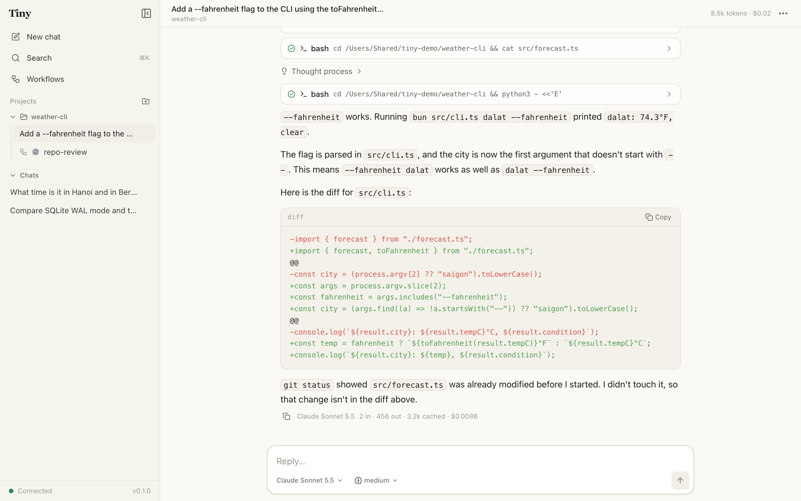
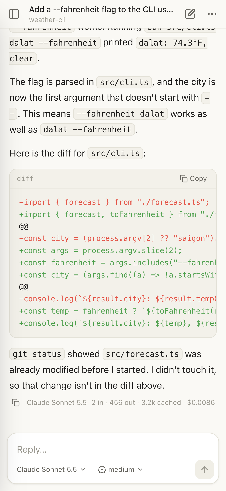
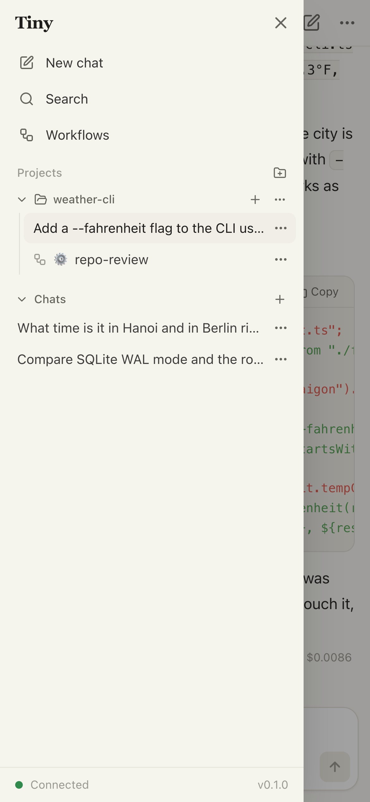
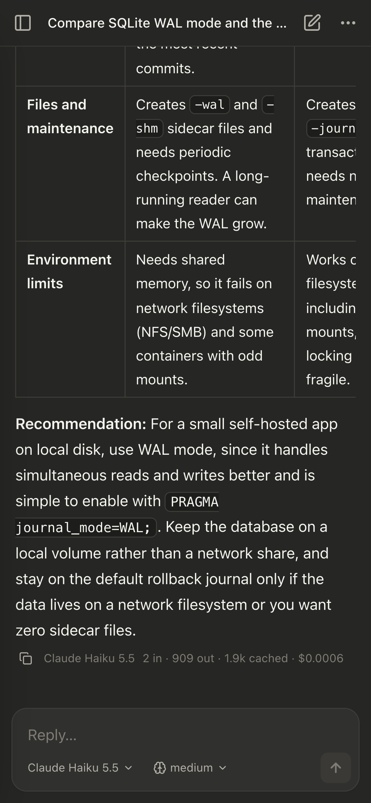
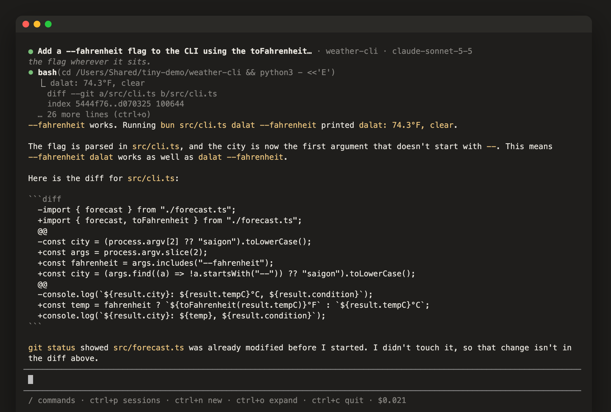
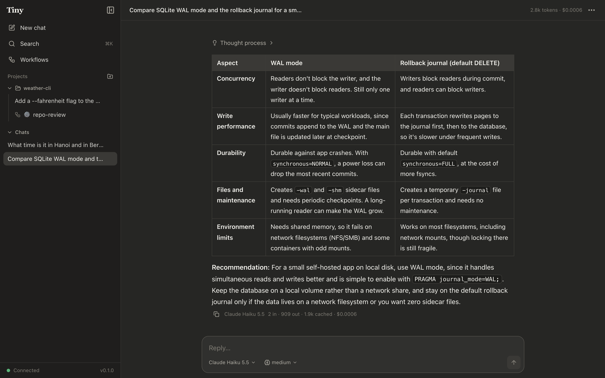
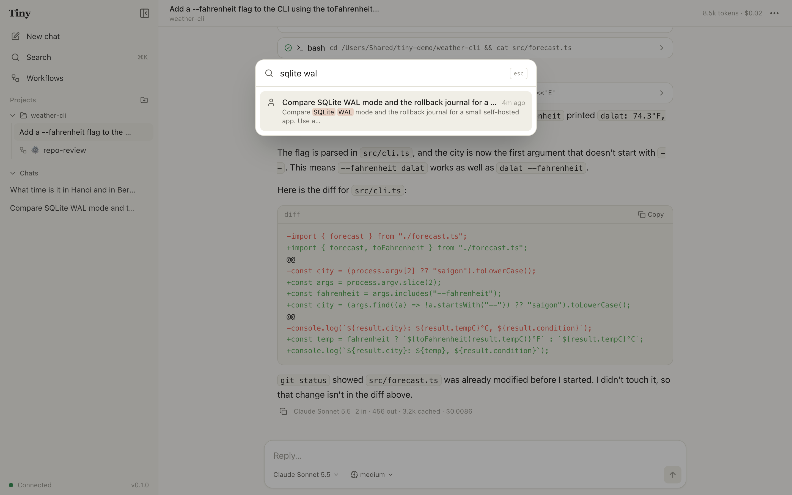
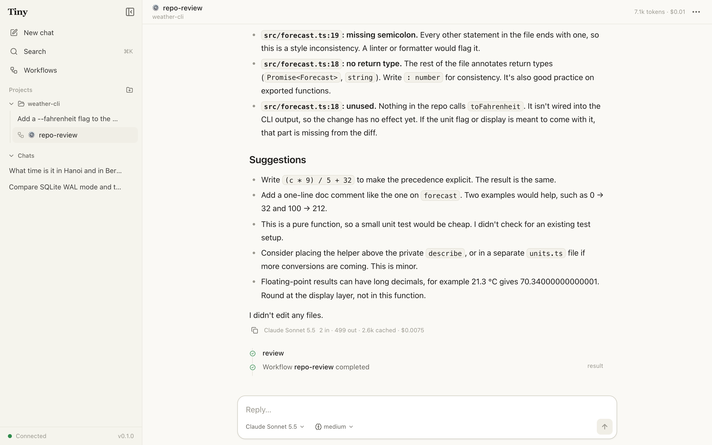

# tiny-assistant

A tiny, self-hosted personal AI assistant. One daemon on your own machine (a Mac mini, say) runs every conversation on
[pi-durable](https://github.com/earendil-works/pi/tree/main/packages/durable); a rich web app (for your phone, over
Tailscale) and a Claude Code-style terminal client connect to it and stay in sync.



<table>
  <tr>
    <td width="33%"></td>
    <td width="33%"></td>
    <td width="33%"></td>
  </tr>
  <tr>
    <td align="center">On your phone, over Tailscale</td>
    <td align="center">Sessions grouped by project</td>
    <td align="center">Dark mode follows the system</td>
  </tr>
</table>



## Features

- **Durable by default.** Every model turn, tool call, and workflow step is committed to SQLite before anything is
  shown. Restart the daemon mid-answer and the work picks up where it stopped.
- **Your Claude subscription.** Models run through the official `claude` CLI via
  [pi-claude-code](https://github.com/earendil-works/pi-claude-code), so it uses your Pro/Max plan. Other providers
  (OpenAI, Anthropic API, Google, OpenRouter, ...) plug in through pi-ai.
- **Code-driven tools and workflows.** Drop TypeScript files into `assistant/`; the daemon hot-reloads them.
- **Sessions and projects.** Start a chat, point it at a project folder, switch between sessions, search everything.
- **One API.** REST + one WebSocket. The web app and the TUI use the same typed client (`@tiny/core`).
- **Logs you can analyze.** Transcripts, per-run tokens, cost, duration, and tool calls live in one SQLite file.

<details>
<summary>More screenshots</summary>

Dark mode on the desktop:



Full-text search across every session (⌘K):



</details>

## How it fits together

```
 phone / laptop browser ─┐                       ┌─ pi-durable Harness ── claude -p (your subscription)
                         ├─ HTTPS (tailscale) ─┐ │   ├─ built-in tools: read, write, edit, bash
 tiny TUI (any machine) ─┘    REST + WebSocket ├─┤   ├─ assistant/tools/*.ts      (hot reload)
                                               │ │   └─ assistant/workflows/*.ts  (durable tasks)
                                daemon (Bun) ──┘ └─ SQLite: transcripts, tasks, sessions, search, run metrics
```

## Requirements

- [Bun](https://bun.sh) ≥ 1.3
- [Claude Code](https://code.claude.com) on your `PATH`, logged in to your subscription: `claude auth login`
- Optional: [Tailscale](https://tailscale.com) to reach the daemon from your phone

## Quick start

```sh
git clone <this repo> tiny-assistant && cd tiny-assistant
make install
make start            # builds the web app, starts the daemon on http://127.0.0.1:7777
make tui              # in another terminal
```

Open <http://127.0.0.1:7777>, or run the TUI.

### On your Mac mini, reachable from your phone

```sh
cp .env.example .env  # adjust if you like
make service-install  # launchd: starts at login, restarts if it dies; logs: make logs
make tailscale-serve  # https://<mac-mini>.<tailnet>.ts.net -> the daemon
```

On the phone, open the tailnet URL and use "Add to Home Screen". Only loopback and tailnet addresses may connect; set
`TINY_ALLOWED_LOGINS` to restrict it to your Tailscale identity, or `TINY_TOKEN` for a shared secret.

### The TUI from any machine

The daemon serves the TUI as one file:

```sh
curl -fsSL https://<mac-mini>.<tailnet>.ts.net/tui.js -o tiny.js
bun tiny.js https://<mac-mini>.<tailnet>.ts.net
```

In the TUI: type to chat, `/` for commands (`/new`, `/sessions`, `/project`, `/model`, `/run`, `/compact`, ...),
`ctrl+p` switches sessions, `ctrl+o` expands tool output and thinking, `esc` stops a run.

## Tools

A tool is a pi-durable tool. Each call runs as its own durable task, its output streams to every client, and the model
gets the result:

```ts
// assistant/tools/now.ts
import { defineTool, obj, opt, str } from "@tiny/core/define";

export default defineTool({
	name: "now",
	description: "Current date and time in an IANA timezone",
	parameters: obj({ timezone: opt(str()) }),
	replay: "safe", // may run again if the daemon dies mid-call
	async execute(args) {
		const zone = args.timezone ?? "UTC";
		return { output: [{ type: "text", text: new Date().toLocaleString("en-GB", { timeZone: zone }) }] };
	},
});
```

A file may export one tool, several, an array, or a whole `defineExtension({ tools, sections, hooks })` (prompt
sections, `beforeTool` approval gates, and more: see the pi-durable README).

## Workflows

A workflow is code that drives the assistant through steps. Each `step()` result is checkpointed, so a run
interrupted by a crash or restart resumes after its last finished step:

```ts
// assistant/workflows/repo-review.ts
import { defineWorkflow, obj, opt, str } from "@tiny/core/define";

export default defineWorkflow({
	name: "repo-review",
	description: "Review uncommitted changes",
	input: obj({ focus: opt(str()) }),
	async run(ctx) {
		const diff = await ctx.exec("git diff --stat", { step: "stat" }); // checkpointed shell command
		if (!diff.output.trim()) return "nothing to review";
		await ctx.log(diff.output); // shows in the transcript
		return ctx.agent(`Review the uncommitted changes. Focus: ${ctx.input.focus ?? "correctness"}`, {
			step: "review", // a normal agent turn in the session, streamed to every client
		});
	},
});
```

Run it from the web app ("Run workflow"), the TUI (`/run repo-review {"focus":"security"}`), or the API
(`POST /api/workflows/run`). Stopping the session stops the run. Each step shows up in the session as it finishes:



`WorkflowContext`: `input`, `sessionId`, `cwd`, `signal`, `step(name, fn)`, `agent(prompt)`, `exec(command)`,
`log(text)`.

Extra instructions for every session go in `assistant/SYSTEM.md`; a project's own `AGENTS.md` or `CLAUDE.md` is
picked up automatically when a session works in that folder.

## API

All clients use `@tiny/core`'s `AssistantClient`. Raw endpoints:

|                                                                                           |                                                                                          |
| ----------------------------------------------------------------------------------------- | ---------------------------------------------------------------------------------------- |
| `GET /api/state`                                                                          | projects, sessions, models, workflows, tools, defaults                                   |
| `POST /api/projects` `{ path, name? }`                                                    | add a project folder                                                                     |
| `GET /api/fs?path=`                                                                       | browse folders (within `TINY_FS_ROOTS`)                                                  |
| `POST /api/sessions` `{ projectId?, model?, thinking?, text? }`                           | new session, optionally with its first message                                           |
| `PATCH /api/sessions/:id` `{ title?, model?, thinking?, projectId?, pinned?, archived? }` |                                                                                          |
| `POST /api/sessions/:id/messages` `{ text, mode? }`                                       | `mode`: `followUp` (default) or `steer`                                                  |
| `POST /api/sessions/:id/abort` · `/compact` · `/reset`                                    |                                                                                          |
| `GET /api/sessions/:id/entries?before=&limit=`                                            | older transcript pages                                                                   |
| `POST /api/workflows/run` `{ name, input?, sessionId?, projectId? }`                      |                                                                                          |
| `GET /api/search?q=`                                                                      | full-text search over all sessions                                                       |
| `GET /api/stats?session=`                                                                 | per-run metrics                                                                          |
| `WS /ws`                                                                                  | `state` / `sessions` broadcasts; `subscribe` to a session for its view, then delta `ops` |

Live sync works like this: for each followed session the daemon holds one pi-durable conversation watch and forwards
its value, then each commit's Chord delta ops, to every client; clients apply them with `applyImmutable`. Everything
on screen is committed state, so the web app and the TUI can't disagree.

## Data

`~/.tiny-assistant/assistant.sqlite` (WAL mode):

- `pi_*`: pi-durable's conversations, entries, tasks, documents
- `app_sessions`, `app_projects`: what the clients list
- `app_runs`: one row per run: model, tokens, cache hits, cost, duration, tool calls, turns
- `app_tool_calls`: every tool call, with errors
- `app_messages_fts`: FTS5 index of user and assistant text

```sh
sqlite3 ~/.tiny-assistant/assistant.sqlite \
  "select model, count(*), sum(output_tokens), avg(duration_ms) from app_runs group by model"
```

## Development

```sh
make dev     # daemon with --watch + Vite dev server on :5173 (proxies /api and /ws)
make check   # format, then lint + typecheck + tests
make ci      # the same, verify-only (for CI)
```

Layout: `packages/core` (protocol, display model, client, authoring API) · `apps/server` (daemon) · `apps/web`
(React) · `apps/tui` (pi-tui) · `assistant/` (your tools and workflows).

## Status

Experimental, like pi-durable and pi-claude-code underneath. Read pi-claude-code's notes on how Anthropic bills
`claude -p` usage before relying on it.

## License

MIT
